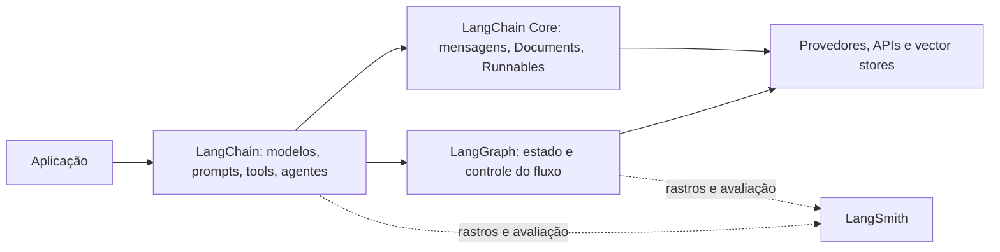

# Nome do Arquivo: 01-visao-geral.md

## LangChain em uma página

- **LangChain** é um framework para montar aplicações com modelos de linguagem, prompts, ferramentas e recuperação de dados.
- Fornece interfaces e componentes reutilizáveis; **não** substitui o modelo, o banco vetorial ou a API do provedor.
- Uma aplicação pode usar só um modelo e um prompt. Adicione agentes, RAG ou grafos quando a necessidade pedir.

> Nota: os exemplos desta coleção seguem as APIs atuais do LangChain para Python 1.x. Integrações de provedores costumam ser instaladas em pacotes separados. Confira a documentação do provedor e o identificador de modelo disponível na sua conta.

## Ecossistema

| Peça | Papel | Use quando |
|---|---|---|
| **LangChain** | APIs de alto nível para modelos, prompts, tools e agentes prontos (`create_agent`). | Quer construir uma aplicação rapidamente com componentes comuns. |
| **LangChain Core** | Interfaces e abstrações centrais: mensagens, documentos, prompts, runnables e parsers. | Quer compor componentes ou escrever integrações reutilizáveis. |
| **LangGraph** | Orquestração explícita com estado, nós, arestas, ciclos, pausa/retomada e persistência. | O fluxo precisa de controle fino, longa duração ou intervenção humana. |
| **LangSmith** | Rastreamento, depuração, avaliação e monitoramento de aplicações de LLM. | Precisa entender execuções, comparar versões ou acompanhar qualidade. |



## Qual peça escolher?

| Necessidade | Comece com |
|---|---|
| Uma chamada de modelo, classificação ou extração | Modelo + `ChatPromptTemplate` + parser (LCEL) |
| Perguntar sobre documentos próprios | RAG: loader + splitter + embeddings + retriever |
| Deixar o modelo escolher entre algumas ações | `create_agent` + tools |
| Regras rígidas, ciclos e caminhos previsíveis | LangGraph (`StateGraph`) |
| Investigar por que uma resposta ou tool falhou | LangSmith tracing |

## Quando usar (e quando não usar)

**Use LangChain quando:**

- Quer trocar de provedor sem reescrever a aplicação toda.
- Precisa conectar modelos a dados, funções ou APIs.
- Quer composição padrão para chamadas, streaming e lotes.
- Quer iniciar com componentes conhecidos e substituí-los conforme aprende sobre o problema.

**Talvez não precise do framework quando:**

- Uma chamada HTTP direta ao provedor resolve o caso com menos código.
- O fluxo é pequeno, fixo e não se beneficia de abstrações ou integrações.
- A aplicação depende de uma capacidade específica do provedor que a interface comum não expõe. Nesse caso, use a integração específica ou a API nativa.
- A latência e a superfície de dependências são críticas e você não usa os recursos de composição.

> Nota: abstração não elimina diferenças entre provedores. Tool calling, saída estruturada, multimodalidade, parâmetros e streaming variam; confirme o suporte antes de trocar de modelo.

## Instalação e primeiro modelo

```bash
pip install -U "langchain[openai]"
```

```python
import os
from langchain.chat_models import init_chat_model

os.environ["OPENAI_API_KEY"] = "..."  # prefira variável de ambiente/secret manager
model = init_chat_model("openai:gpt-4.1-mini")

answer = model.invoke("Resuma LangChain em uma frase.")
print(answer.text)
```

- `init_chat_model` inicializa um modelo pelo identificador `provedor:model`.
- Troque o provedor/modelo conforme as credenciais e integrações instaladas.
- Continue em [[02-modelos-e-prompts]] para prompts e saídas, [[04-lcel-e-chains]] para composição, [[05-agentes-e-tools]] para agentes e [[06-langgraph]] para fluxos com estado.

### Links oficiais

- [LangChain: visão geral e componentes](https://docs.langchain.com/oss/python/langchain/overview)
- [LangChain: modelos](https://docs.langchain.com/oss/python/langchain/models)
- [LangGraph: visão geral](https://docs.langchain.com/oss/python/langgraph/overview)
- [LangSmith: tracing](https://docs.langchain.com/langsmith/observability)
