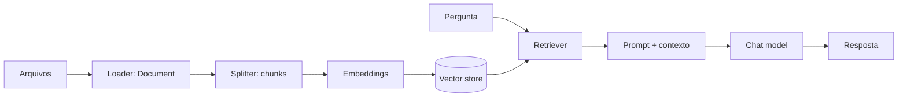

# Nome do Arquivo: 03-rag-e-vetores.md

## RAG em uma linha

**RAG** (Retrieval-Augmented Generation) busca trechos relevantes em uma coleção e os fornece como contexto ao modelo. A aplicação controla a recuperação; o modelo redige a resposta.



## Componentes

| Componente | Responsabilidade | Lembrete |
|---|---|---|
| **Document loader** | Lê arquivos, páginas ou fontes e produz `Document(page_content, metadata)`. | Um loader pode exigir integração ou dependência extra. |
| **Text splitter** | Divide documentos em pedaços menores. | Mantenha metadados e evite quebrar estruturas importantes. |
| **Embeddings** | Converte texto e consultas em vetores numéricos. | Use modelo e configuração compatíveis ao indexar e consultar. |
| **Vector store** | Persiste vetores/documentos e oferece busca por similaridade e filtros. | Escolha persistência, filtros e escala de acordo com o caso. |
| **Retriever** | Interface de busca que recebe uma consulta e devolve documentos. | Ajuste `k`, filtros, diversidade e reranking com medições. |

> Nota: `chunk_size` e `chunk_overlap` são escolhas de engenharia, não constantes universais. Avalie qualidade da busca, custo, latência e limites de contexto com dados representativos.

## Indexação e busca local

Dependências para este exemplo: `pip install -U langchain-openai langchain-community langchain-text-splitters`. Crie `dados.txt` e configure `OPENAI_API_KEY`.

```python
from langchain_community.document_loaders import TextLoader
from langchain_core.vectorstores import InMemoryVectorStore
from langchain_openai import OpenAIEmbeddings
from langchain_text_splitters import RecursiveCharacterTextSplitter

# Ingestão
documents = TextLoader("dados.txt", encoding="utf-8").load()
splitter = RecursiveCharacterTextSplitter(chunk_size=800, chunk_overlap=120)
chunks = splitter.split_documents(documents)

embeddings = OpenAIEmbeddings(model="text-embedding-3-small")
vector_store = InMemoryVectorStore(embedding=embeddings)
vector_store.add_documents(chunks)

# Busca sem geração
matches = vector_store.similarity_search("Como funciona o produto?", k=3)
for doc in matches:
    print(doc.metadata, doc.page_content[:240])
```

- O `InMemoryVectorStore` é útil para demonstração e protótipos: os dados ficam na memória do processo.
- Para uso durável ou distribuído, escolha um vector store persistente compatível com a integração e as necessidades do projeto.
- Guarde `source`, página, identificador e outros metadados úteis para filtros e citações.

## RAG mínimo com LCEL

Com `chunks`, `vector_store` e o mesmo modelo de embeddings já inicializados acima:

```python
from langchain.chat_models import init_chat_model
from langchain_core.output_parsers import StrOutputParser
from langchain_core.prompts import ChatPromptTemplate
from langchain_core.runnables import RunnableLambda, RunnablePassthrough

retriever = vector_store.as_retriever(search_kwargs={"k": 3})

def format_docs(docs):
    return "\n\n".join(doc.page_content for doc in docs)

prompt = ChatPromptTemplate.from_template("""Responda usando somente o contexto.
Se não houver informação suficiente, diga que não sabe.

Contexto:
{context}

Pergunta: {question}
Resposta:""")

model = init_chat_model("openai:gpt-4.1-mini", temperature=0)
rag_chain = (
    {
        "context": retriever | RunnableLambda(format_docs),
        "question": RunnablePassthrough(),
    }
    | prompt
    | model
    | StrOutputParser()
)

answer = rag_chain.invoke("Quais são os pontos principais do arquivo?")
print(answer)
```

## Checklist de qualidade

- [ ] O loader extrai texto utilizável e metadados corretos?
- [ ] Os chunks preservam títulos, seções e contexto suficiente?
- [ ] A consulta retorna evidência relevante? Ajuste `k`, filtros ou estratégia de busca.
- [ ] A resposta está ancorada nos trechos? Mostre fontes quando necessário.
- [ ] O pipeline foi avaliado com perguntas reais, casos sem resposta e conteúdo atualizado?

Para prompts/modelos veja [[02-modelos-e-prompts]]. Para conectar RAG a tools ou agentes, consulte [[05-agentes-e-tools]]; para fluxos com ramificações controladas, [[06-langgraph]].

### Links oficiais

- [RAG e recuperação](https://docs.langchain.com/oss/python/langchain/rag)
- [Document loaders](https://docs.langchain.com/oss/python/integrations/document_loaders)
- [Text splitters](https://docs.langchain.com/oss/python/integrations/splitters)
- [Embeddings](https://docs.langchain.com/oss/python/integrations/embeddings)
- [Vector stores](https://docs.langchain.com/oss/python/integrations/vectorstores)
