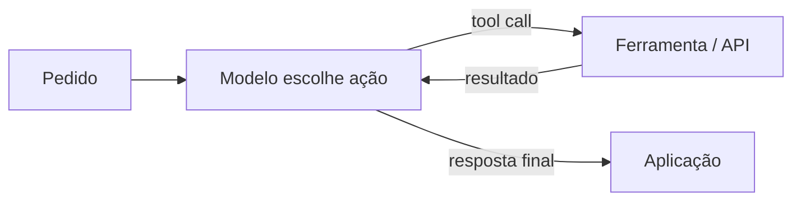

# Nome do Arquivo: 05-agentes-e-tools.md

## Agente, modelo e ferramenta

- **Tool**: função com nome, descrição, argumentos e implementação executável.
- **Tool calling**: o modelo decide solicitar uma ferramenta e fornece argumentos estruturados.
- **Agente**: executa o ciclo modelo → tool(s) → resultado(s) → modelo até responder ou atingir um limite.
- Em LangChain moderno, `create_agent` fornece um agente de alto nível; a implementação usa o runtime do LangGraph.



> Nota: a decisão do modelo sobre quando e como chamar uma ferramenta não é determinística. Para um processo fixo, prefira chamadas explícitas ou um grafo controlado em [[06-langgraph]].

## Criar uma tool para uma API externa

Este exemplo consulta a API pública do GitHub. Instale `pip install -U "langchain[openai]" requests` e configure `OPENAI_API_KEY`.

```python
import requests
from langchain.agents import create_agent
from langchain.chat_models import init_chat_model
from langchain.tools import tool

@tool
def github_stars(repo: str) -> int:
    """Retorna o número atual de estrelas de um repositório público do GitHub.

    Args:
        repo: Repositório no formato 'organizacao/nome'.
    """
    owner, separator, name = repo.strip().partition("/")
    if not separator or not owner or not name or "/" in name:
        raise ValueError("Use o formato 'organizacao/nome'.")

    response = requests.get(
        f"https://api.github.com/repos/{owner}/{name}",
        timeout=10,
    )
    response.raise_for_status()
    return int(response.json()["stargazers_count"])

model = init_chat_model("openai:gpt-4.1-mini", temperature=0)
agent = create_agent(
    model=model,
    tools=[github_stars],
    system_prompt="Responda em português. Use a ferramenta para consultar estrelas atuais.",
)

result = agent.invoke({
    "messages": [{"role": "user", "content": "Quantas estrelas tem langchain-ai/langchain?"}]
})
print(result["messages"][-1].text)
```

## Como desenhar boas ferramentas

- **Uma responsabilidade por tool**; prefira ações pequenas que sejam fáceis de testar.
- Use nomes e docstrings que expliquem quando chamar a ferramenta. Anotações de tipo descrevem argumentos e retorno.
- Valide formatos, faixas e permissões dentro da função: o schema ajuda o modelo, mas não é uma barreira de segurança.
- Defina timeout, tratamento de erro, limites de taxa e autenticação. Não coloque chaves no prompt nem em código versionado.
- Retorne dados concisos e úteis; evite despejar respostas enormes da API no contexto.
- Registre e monitore operações. Para escrita, pagamentos, exclusões ou ações irreversíveis, exija confirmação e aplique autorização fora do LLM.

## Tool avulsa vs agente

| Situação | Escolha |
|---|---|
| A aplicação já sabe qual API chamar | Chame a função diretamente. |
| O modelo precisa selecionar entre ferramentas conhecidas | `create_agent(model=..., tools=[...])`. |
| A sequência é fixa ou tem regras de negócio rígidas | LCEL ou LangGraph controlado. |
| A operação tem efeito externo ou risco | Aprovação explícita, escopos mínimos e idempotência. |

Próximo: [[06-langgraph]] para controlar ciclo, estado e retomada. Para recuperar documentos como ferramenta, combine com [[03-rag-e-vetores]].

### Links oficiais

- [Agentes LangChain](https://docs.langchain.com/oss/python/langchain/agents)
- [Tools](https://docs.langchain.com/oss/python/langchain/tools)
- [Tool calling em modelos](https://docs.langchain.com/oss/python/langchain/models#tool-calling)
