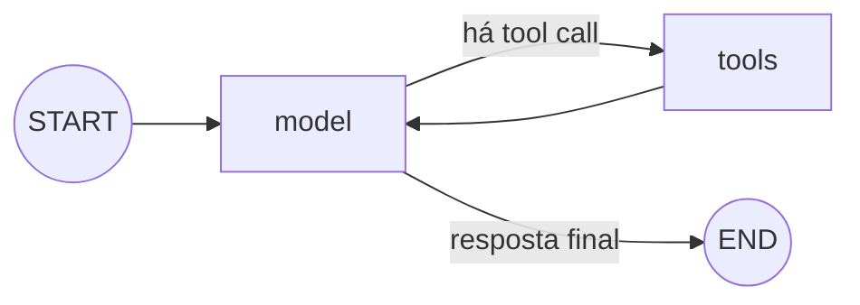

# Nome do Arquivo: 06-langgraph.md

## LangGraph em uma página

**LangGraph** é uma biblioteca de orquestração para aplicações com estado e fluxos que podem ter ciclos. O grafo compilado é executável e pode ser invocado, transmitido em streaming e conectado a um checkpointer.

| Conceito | Significado |
|---|---|
| **State** | Dados compartilhados entre etapas: mensagens, resultados, contadores etc. |
| **Node** | Função que lê o estado e retorna atualizações parciais. |
| **Edge** | Próxima etapa fixa ou rota condicional. |
| **Reducer** | Regra para combinar atualizações num campo, como anexar mensagens. |
| **Checkpointer** | Salva snapshots do estado por `thread_id`, permitindo continuar uma execução. |



## Exemplo: agente com ciclo e persistência de conversa

Instale `pip install -U langgraph "langchain[openai]"` e defina `OPENAI_API_KEY`.

```python
from langchain.chat_models import init_chat_model
from langchain.tools import tool
from langgraph.checkpoint.memory import InMemorySaver
from langgraph.graph import MessagesState, START, StateGraph
from langgraph.prebuilt import ToolNode, tools_condition

@tool
def somar(a: int, b: int) -> int:
    """Soma dois números inteiros.

    Args:
        a: Primeiro número.
        b: Segundo número.
    """
    return a + b

tools = [somar]
model = init_chat_model("openai:gpt-4.1-mini", temperature=0)
model_with_tools = model.bind_tools(tools)

def chamar_modelo(state: MessagesState):
    return {"messages": [model_with_tools.invoke(state["messages"])]}

builder = StateGraph(MessagesState)
builder.add_node("model", chamar_modelo)
builder.add_node("tools", ToolNode(tools))
builder.add_edge(START, "model")
builder.add_conditional_edges("model", tools_condition)  # tools ou END
builder.add_edge("tools", "model")                       # volta ao modelo

graph = builder.compile(checkpointer=InMemorySaver())
config = {"configurable": {"thread_id": "estudo-01"}}

first = graph.invoke(
    {"messages": [{"role": "user", "content": "Quanto é 19 + 23?"}]},
    config=config,
)
print(first["messages"][-1].text)

# Mesmo thread_id: o checkpointer mantém o estado da conversa entre chamadas.
follow_up = graph.invoke(
    {"messages": [{"role": "user", "content": "E se eu somar mais 8?"}]},
    config=config,
)
print(follow_up["messages"][-1].text)
```

### Leitura do código

1. `MessagesState` define o estado com histórico de mensagens e um reducer que as combina.
2. `chamar_modelo` atualiza o estado acrescentando a mensagem do modelo.
3. `tools_condition` encaminha para `tools` se houver solicitação de tool; caso contrário, encerra.
4. A aresta `tools → model` cria o ciclo: o modelo vê os resultados antes de responder.
5. `thread_id` seleciona a conversa persistida pelo checkpointer.

## Persistência e memória

| Opção | Escopo | Uso |
|---|---|---|
| `InMemorySaver` | Checkpoints em RAM | Estudos, protótipos e exemplos locais. |
| Checkpointer persistente (por exemplo, Postgres) | Estado durável por thread | Produção, recuperação após reinício e fluxos longos. |
| Store | Dados compartilhados entre threads | Preferências ou fatos duráveis do usuário. |

> Nota: `InMemorySaver` perde os dados ao reiniciar o processo. Para produção, escolha um checkpointer persistente, proteja o acesso por thread e defina retenção de checkpoints. Checkpoint de conversa e memória de longo prazo (`Store`) resolvem problemas diferentes.

## Quando escolher LangGraph

- Precisa ver e controlar o caminho de execução passo a passo.
- O agente tem ciclos, ramificações, revisão humana ou tarefas longas.
- Precisa pausar/retomar, recuperar falhas ou manter estado entre chamadas.
- Quer compor subgrafos e delimitar claramente as atualizações de estado.

Se o caso for apenas um prompt seguido de modelo e parser, comece com [[04-lcel-e-chains]]. Se quer o ciclo de tools pronto, comece por [[05-agentes-e-tools]] e use LangGraph diretamente quando precisar de controle mais fino.

### Links oficiais

- [LangGraph: Graph API](https://docs.langchain.com/oss/python/langgraph/graph-api)
- [LangGraph: quickstart](https://docs.langchain.com/oss/python/langgraph/quickstart)
- [LangGraph: persistência](https://docs.langchain.com/oss/python/langgraph/persistence)
